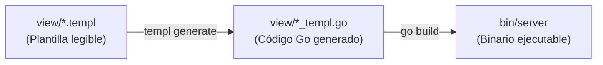

# Documentación Técnica: Sistema de Vistas con Templ y Modificaciones Realizadas

Este documento detalla todas las modificaciones implementadas en el proyecto, así como una guía completa y didáctica sobre la arquitectura y el funcionamiento del sistema de plantillas **Templ** (`*.templ` y `*_templ.go`) en Go.

---

## Índice
1. [Resumen de Modificaciones Realizadas](#1-resumen-de-modificaciones-realizadas)
   - [Corrección del Error de Compilación inicial (`undefined: db.Usuario`)](#corrección-del-error-de-compilación-inicial-undefined-dbusuario)
   - [Vistas Provisionales de Materias y Calendario (TP6)](#vistas-provisionales-de-materias-y-calendario-tp6)
   - [Configuración de Scripts y Makefile](#configuración-de-scripts-y-makefile)
2. [Arquitectura de Vistas en Go con Templ](#2-arquitectura-de-vistas-en-go-con-templ)
   - [¿Qué es Templ?](#qué-es-templ)
   - [El ciclo `.templ` $\rightarrow$ `*_templ.go`](#el-ciclo-templ-rightarrow-_templgo)
   - [Estructura de Componentes y Composición](#estructura-de-componentes-y-composición)
   - [Tipado Fuerte y Modelos de Base de Datos](#tipado-fuerte-y-modelos-de-base-de-datos)
   - [Integración con los Handlers HTTP de Go](#integración-con-los-handlers-http-de-go)
3. [Flujo de Trabajo para el Desarrollador](#3-flujo-de-trabajo-para-el-desarrollador)
   - [Comandos frecuentes](#comandos-frecuentes)

---

## 1. Resumen de Modificaciones Realizadas

### Corrección del Error de Compilación inicial (`undefined: db.Usuario`)
- **Causa del problema**: Los archivos `view/layout_templ.go` y `view/usuario_templ.go` consumían el tipo Go `db.Usuario`. Dicho struct es generado automáticamente por la herramienta **sqlc** a partir de `db/schema.sql`. Al encontrarse los archivos generados dentro de `.gitignore`, no existían en el entorno de trabajo, provocando que `go build` fallara.
- **Solución implementada**:
  1. Se ejecutó `sqlc generate` para regenerar `db/models.go`, `db/db.go` y `db/queries.sql.go`.
  2. Se configuró [tests/server.sh](tests/server.sh) para verificar y ejecutar automáticamente `sqlc generate` antes de compilar el binario del servidor.
  3. Se actualizó el [Makefile](Makefile) encadenando la regla `start: generate`.

### Vistas Provisionales de Materias y Calendario (TP6)
- **Requerimiento**: Al presionar en la barra superior los botones de **Materias** y **Calendario**, debía mostrarse únicamente un mensaje en grande indicando que la funcionalidad corresponde a la próxima entrega (TP6), acompañado de un botón interactivo para volver a la página anterior.
- **Implementación**:
  1. **Componente Templ (`view/usuario.templ`)**: Se actualizó el componente `TP6Aviso` removiendo carteles secundarios o de bienvenida, dejando un `<h1>` destacado (`.tp6-title-big`) con el texto:
     > *"Esta funcionalidad se implementará en la próxima entrega TP6"*
     y un botón con navegación de historial:
     ```html
     <button type="button" onclick="if (history.length > 1) { history.back(); } else { window.location.href='/usuarios'; }" class="btn btn-primary">
       <i class="fa-solid fa-arrow-left"></i>
       <span>Volver a la página anterior</span>
     </button>
     ```
  2. **Regeneración de código Go**: Se regeneró [view/usuario_templ.go](view/usuario_templ.go) con el compilador `templ`.
  3. **Estilos CSS nativos (`static/css/style.css`)**: Se añadió la clase `.tp6-title-big` con diseño responsive adaptativo a dispositivos móviles.
  4. **Páginas estáticas de soporte**: Se actualizaron [static/calendario.html](static/calendario.html) y [static/materias.html](static/materias.html) con el mismo mensaje y comportamiento de retroceso.

---

## 2. Arquitectura de Vistas en Go con Templ

### ¿Qué es Templ?
**Templ** es un motor de plantillas para el lenguaje Go que permite escribir código similar a HTML y JSX, pero con las siguientes ventajas:
1. **Tipado Estático y Seguro**: Los errores de sintaxis, variables inexistentes o tipos incompatibles se detectan en tiempo de compilación de Go, no en tiempo de ejecución.
2. **Rendimiento Nativo**: En lugar de interpretar cadenas de texto en runtime (como hace `html/template`), Templ compila el marcado a funciones Go nativas y optimizadas que escriben directamente en un `io.Writer`.
3. **Protección XSS Automática**: Cualquier contenido interpolado se sanitiza automáticamente contra ataques Cross-Site Scripting.

### El ciclo `.templ` $\rightarrow$ `*_templ.go`



1. **El archivo fuente (`.templ`)**:
   Es el archivo donde el programador escribe los componentes, define la estructura HTML y utiliza sentencias de Go (`if`, `for`, llamadas a funciones).
2. **El archivo generado (`_templ.go`)**:
   Es un archivo Go generado automáticamente por la CLI de Templ (`templ generate`). **No debe editarse a mano**, ya que cualquier cambio se sobrescribe al regenerar. Este archivo contiene la implementación de la interfaz `templ.Component`.

### Estructura de Componentes y Composición

En Templ, cada componente es análogo a una función de Go.

#### 1. Layout Base y Contenido Anidado (`children...`)
En [view/layout.templ](view/layout.templ):
```templ
templ LayoutBase(titulo string, usuarioActivo string) {
    <!DOCTYPE html>
    <html lang="es">
        <head>
            <title>{ titulo }</title>
            <link rel="stylesheet" href="/css/style.css"/>
        </head>
        <body>
            <header class="site-header">
                <!-- Barra de navegación global -->
            </header>
            <main class="main-wrapper">
                { children... } <!-- Inyección del contenido específico -->
            </main>
        </body>
    </html>
}
```
La expresión `{ children... }` permite componer vistas, inyectando un componente hijo dentro del contenedor del layout principal.

#### 2. Llamada a un Layout desde otro Componente
En [view/usuario.templ](view/usuario.templ):
```templ
templ TP6Aviso(usuarioNombre string) {
    @LayoutBase("go_tasks - Próxima Entrega TP6", usuarioNombre) {
        <div class="tp6-card">
            <h1 class="tp6-title-big">Esta funcionalidad se implementará en la próxima entrega TP6</h1>
            ...
        </div>
    }
}
```
El símbolo `@` invoca a otro componente Templ pasando como bloque hijo lo contenido entre las llaves `{ ... }`.

### Tipado Fuerte y Modelos de Base de Datos
Templ permite recibir parámetros tipados directamente desde paquetes del proyecto, como `db.Usuario` generado por **sqlc**:

```templ
package view

import (
    "ServidorEntregable/db"
    "fmt"
)

templ ListaUsuarios(usuarios []db.Usuario, usuarioActivoID int32) {
    if len(usuarios) == 0 {
        <p>No se han creado usuarios.</p>
    } else {
        for _, u := range usuarios {
            <article>
                <h3>{ u.Nombre } { u.Apellido }</h3>
                <span>{ u.Email }</span>
            </article>
        }
    }
}
```
Si el campo `u.Email` cambia o se escribe incorrectamente, el compilador de Go arrojará un error inmediato al compilar el proyecto.

### Integración con los Handlers HTTP de Go
Para enviar la vista al navegador web, los handlers HTTP instancian el componente y llaman a su método `.Render()`:

En [handlers/usuario_handler.go](handlers/usuario_handler.go):
```go
func TP6View(w http.ResponseWriter, r *http.Request) {
    nombre := r.URL.Query().Get("nombre")
    if nombre == "" {
        nombre = "Usuario"
    }

    // 1. Establecer el encabezado de respuesta HTML
    w.Header().Set("Content-Type", "text/html; charset=utf-8")

    // 2. Renderizar el componente Templ en el ResponseWriter
    err := view.TP6Aviso(nombre).Render(r.Context(), w)
    if err != nil {
        http.Error(w, "Error al renderizar la vista", http.StatusInternalServerError)
    }
}
```

---

## 3. Flujo de Trabajo para el Desarrollador

### Comandos frecuentes

| Acción | Comando |
| :--- | :--- |
| **Generar código SQL (sqlc)** | `make generate` o `sqlc generate` |
| **Generar código de vistas Templ** | `templ generate` |
| **Compilar el servidor Go** | `go build -o bin/server .` |
| **Levantar DB y Servidor** | `make start` |
| **Ver estado del entorno** | `make status` |
| **Ver logs del servidor** | `make logs` |
| **Detener servidor** | `make stop` |
| **Detener servidor y base de datos** | `make stop-all` |
| **Ejecutar suite de tests** | `make test` |
